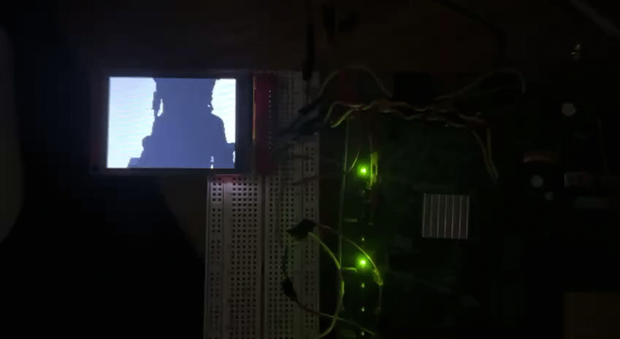
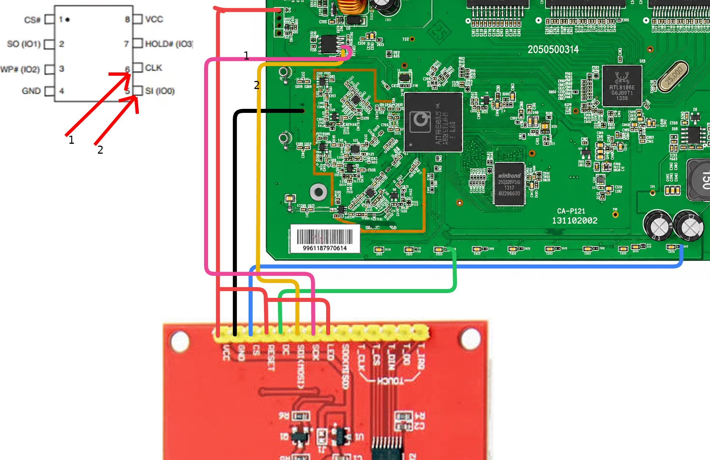

<div align="center">

# ILI9341 on a router


### **I connected a screen to an old router with no extra boards, using a driver I wrote myself**

<sub>TP-Link TL-WR1043ND v2.1 · OpenWrt 19.07.10 (ar71xx, kernel 4.14.275) · ILI9341 2.8" SPI TFT</sub>



<sub>This is not a universal guide. Your router will have different pins, a different SoC and a different kernel.<br>I just want to show that it can be done and tell how I did it on mine.</sub>

</div>

## Versions

- **[v2] (root of this repo, current)** - the display is a real SPI device on the same
  bus as the flash chip, so it shows up as `/dev/spidev0.1`
- **[v1](v1.0/)** - old method, software SPI over the GPIO pins of the LEDs.
  Tag `v1.0`.

v1 worked, but it was slow because it used software SPI (bit-banging GPIO from userspace), 
requiring the CPU to manually toggle GPIO pins for every bit. It achieved approximately 5 FPS.
With v2, I use hardware SPI through the routers flash SPI bus, exposing a second SPI device 
(/dev/spidev0.1) for the TFT. This eliminates software bit-banging and significantly reduces CPU overhead.
With v2 I get about 30 FPS!
## How it works

The SPI flash of the router sits on SPI bus 0 with CS0. I did not want to touch
it, so the display gets its own chip select on a GPIO (GPIO15).

The problem is that the `ath79-spi` driver registers the bus with
`num_chipselect = 1`, and the kernel refuses to add any device with
CS >= 1 (`cs1 >= max 1`). A device tree overlay is not an option on
ar71xx, so I wrote a tiny kernel module (`spidevnew.c`):

1. finds SPI bus 0
2. raises `num_chipselect` by one
3. registers a `spidev` device with `cs_gpio = 15`
4. puts everything back on `rmmod`

The real chip select is handled by the driver using `cs_gpio`, so the
fake `num_chipselect` is only there to make the kernel happy.

After `insmod` you get `/dev/spidev0.1` and can talk to the display from
userspace like with any other spidev.

## Hardware

- TP-Link TL-WR1043ND v2.1
- ILI9341 SPI display, 2.8 size
- thin wires, soldering iron, HANDS

### Wiring

| Display | Router               |
|---------|----------------------|
| VCC     | 3.3V                 |
| GND     | GND                  |
| SCK     | Pin 6 (flash CLK)    |
| MOSI    | Pin 5 (flash SI)     |
| CS      | GPIO15               |
| DC      | LED DS5              |
| RESET   | 3.3v (VCC)           |
| LED     | GPIO12               |



I soldered directly to flash chip legs. The display
is 3.3V logic, do not connect it to 5V.

MISO is not connected because the display does not send anything back.

## Building the module

I built it on a Raspberry Pi 3 (aarch64) using the official OpenWrt SDK
for ar71xx:

1. download the SDK `openwrt-sdk-19.07.10-ar71xx-generic_gcc-7.5.0_musl.Linux-x86_64`
2. unpack it
3. edit the paths at the top of `build.sh` if yours are different
4. run `sh build.sh`

You will get `spidevnew.ko`.

Do not run `make prepare` in the SDK. It wants Python 2 and fails, but the
kernel tree inside the SDK is already prepared, so you don't need it.
The `runas.so` errors in the output are harmless, `build.sh` unsets `LD_PRELOAD`
to hide them.

A prebuilt `spidevnew.ko` is in the [releases](../../releases). It only works with
**ar71xx, kernel 4.14.275, OpenWrt 19.07.10**. On any other kernel
`insmod` will refuse it.

## Running it on the router

Copy `spidevnew.ko` and `loadtft.sh` to `/root/driver/` on the router and run:

```
sh loadtft.sh
```

What the script does:

- loads the module (and tries again if the first try fails)
- unbinds the `leds-gpio` driver, because it holds the GPIO pins
- exports GPIO12 and turns the backlight on
- checks that `/dev/spidev0.1` exists

Side effect: after this the LEDs of the router stop working.

## Known problems

- The display shares the bus with the flash. I have not tested what happens if
  something writes to the flash while the screen is updating. Better not to
  try (especially during a sysupgrade lol).
- LEDs are gone until reboot.
- TODO: Occasional frame glitches at higher SPI speeds; aiming for a stable,
  consistent 20–30 FPS without visual artifacts

> [!WARNING]
> You are soldering to the board of your router. You can kill it.
> Make a backup of the firmware first. Do it at your own risk.

by lyricss1

## License

GPL-2.0, see LICENSE.
