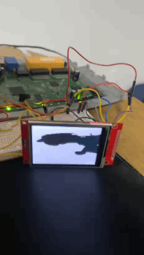
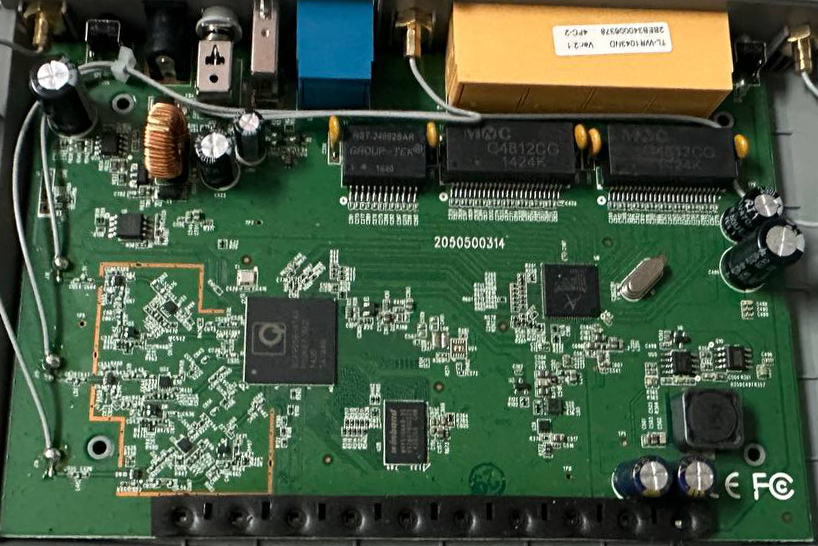
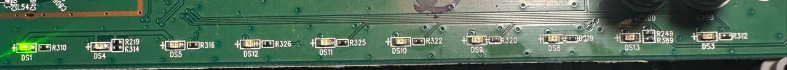
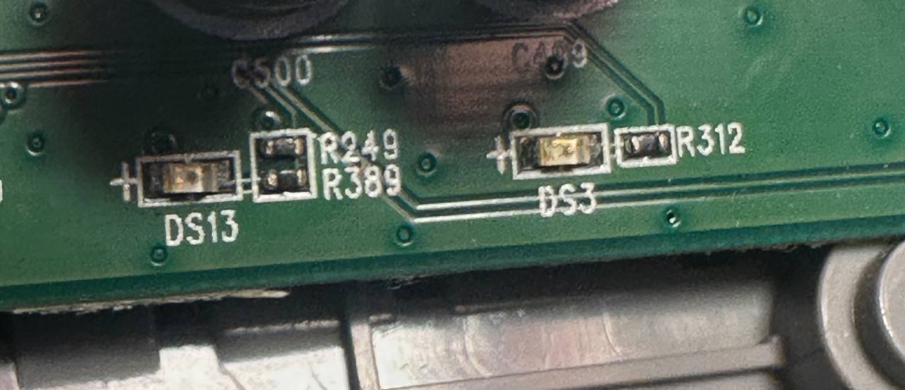
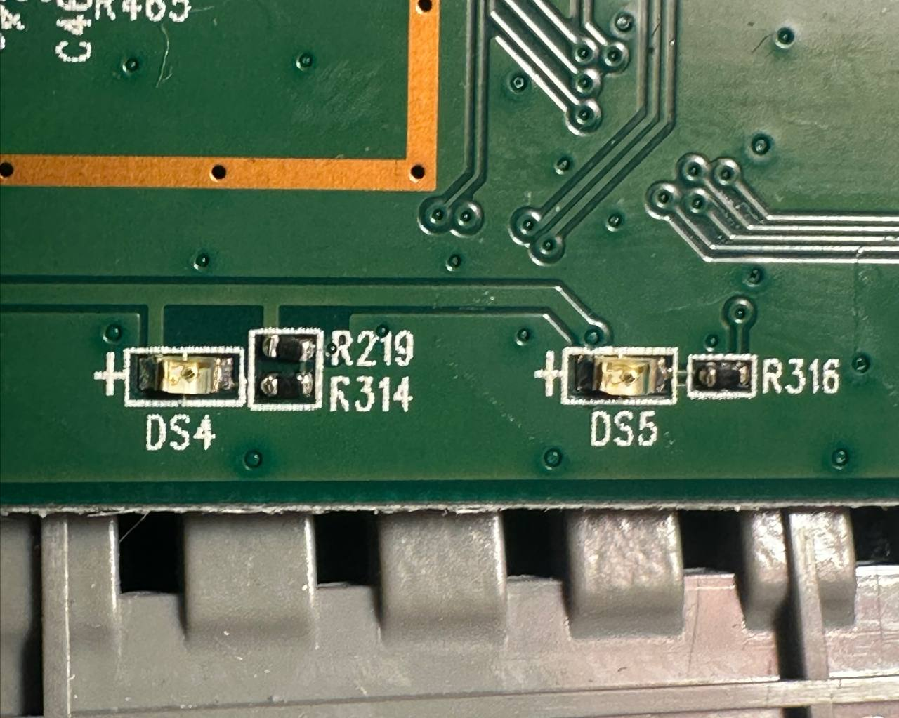
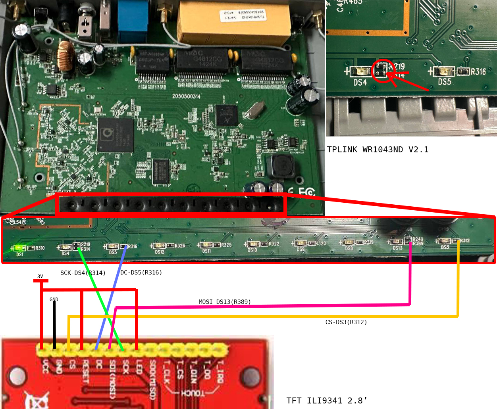

# TP-Link WR1043ND v2 + ILI9341

Experiments with an ILI9341 SPI display connected to a TP-Link WR1043ND v2 running OpenWrt.

The idea started pretty simple: I had an old router and a small TFT display, so I wanted to see how far I could push it. First I got the display working, then started drawing to it from C, and eventually got a small Bad Apple video playing on the screen.

Now I'm looking into the SPI transfer bottleneck and whether it is possible to make the display fast enough for a Doom port.

This is a work in progress. There is no custom display kernel driver or working Doom port yet.

## Current result



The display works, solid fills work, and the current C player can play a short monochrome Bad Apple clip.

Current playback speed is around **4.7–5.4 FPS**, even though the source data is encoded at 10 FPS. The next goal is to understand where the time is going and improve the transfer pipeline.

## Hardware

| Component | Details |
| --- | --- |
| Router | TP-Link TL-WR1043ND v2 |
| SoC | Qualcomm Atheros QCA9558 |
| CPU | MIPS 74Kc, 720 MHz |
| RAM | 64 MB |
| Flash | 8 MB |
| Firmware | OpenWrt 19.07.10 |
| Kernel | Linux 4.14.275 |
| Display | 2.8-inch ILI9341 TFT, 240 × 320 |
| Display interface | SPI |
| Display data/command signal | GPIO12 |
| SPI device | `/dev/spidev1.0` |

The router uses a GPIO-based SPI setup for the display. This is important because the transfer speed is limited by more than just the SPI clock setting: CPU overhead, GPIO switching and the way data is sent all matter.

The project is specific to my hardware revision and current firmware. Do not assume the same GPIOs or scripts will work on a different WR1043ND revision.

## photos

### Router and PCB



### LED areas used during the hardware work







These photos document the physical board and the areas involved in the hardware modifications. Check the wiring and actual board revision before reproducing any soldering work.

### Display wiring



The current setup uses an ILI9341 over SPI. The exact wiring and GPIO assignments should be checked against the working hardware before connecting power.

## Repository layout

```text
.
├── docs/       # Hardware photos, wiring and test results
├── scripts/    # Display initialization and SPI setup
├── src/        # C source code and test data
└── tools/      # Build helpers (planned)
```

### `src/`

- `badapple2.c` — current C video player.
- `spibench.c` — userspace SPI benchmark.
- `spibench_k.c` — kernel-related SPI benchmark experiment; its build and runtime requirements need to be documented separately.
- `badapple.baf.gz` — compressed test video data.

### `scripts/`

- `lcd.sh` — shell functions for initializing the ILI9341 and drawing test patterns.
- `tftup-8m.sh` — configures the GPIO-based SPI setup using the parameters currently used by this project.

## Software requirements

On the router:

- OpenWrt 19.07.10, as used in the current setup.
- The `spidev` device `/dev/spidev1.0`.
- GPIO access for GPIO12.
- `gzip` to unpack the sample video.
- The compiled `badapple2` executable for playback.

On the development machine:

- Git.
- An OpenWrt SDK matching the target firmware for cross-compiling the userspace programs.
- A Linux environment or Docker for a reproducible build setup (planned).

The repository does not currently include the complete OpenWrt SDK or a ready-to-use kernel build tree.

## Setting up the display

**Warning:** `tftup-8m.sh` unbinds the GPIO LED driver and reloads the custom SPI module. This changes device configuration and may affect the router's LEDs or GPIO assignments. Review the script before running it, and make sure you have a reliable way to recover the router if something goes wrong.

Copy the scripts to the router, for example into `/root/`, then connect over SSH.

Run the SPI setup script:

```sh
sh /root/tftup-8m.sh
```

Check that the SPI device exists:

```sh
ls -l /dev/spidev1.0
```

The script requests an 8 MHz clock in the GPIO SPI module configuration. This is a configuration value, not proof that the physical bus achieves 8 MHz.

### Testing the display

Load the shell functions into the current shell:

```sh
. /root/lcd.sh
```

Initialize the display:

```sh
init2
```

Fill the screen with a solid color:

```sh
fill '\377\377'
```

The `fill` function takes a two-byte RGB565 color value. `\377\377` represents `0xFFFF` (white).

Other examples:

```sh
fill '\000\000'  # black
fill '\370\000'  # red RGB565 value
```

These are simple smoke tests to verify that initialization and pixel transfers are working before running the video player.

## Playing Bad Apple

The video player expects the raw `.baf` data, not the compressed `.gz` file. The included archive can be decompressed on the router:

```sh
gzip -dc /overlay/badapple.baf.gz > /tmp/badapple.baf
```

Copy the compiled `badapple2` binary to `/root/badapple2`, then run:

```sh
/root/badapple2 /tmp/badapple.baf
```

The raw video is about 480,000 bytes: 160 × 120 pixels, one bit per pixel, 200 frames. The encoded frame rate is 10 FPS.

The player updates changed image areas instead of blindly sending every pixel on every frame. Actual playback speed depends on the router and current SPI implementation.

## SPI performance

One initial test wrote 1 MiB to `/dev/spidev1.0` in approximately 5.24 seconds.

That corresponds to about **192 KiB/s of userspace write throughput** for that particular test. It is not a precise measurement of the physical SPI wire speed, and the benchmark should be repeated under controlled conditions before comparing optimizations.

A full 240 × 320 frame using RGB565 requires:

```text
240 × 320 × 2 = 153,600 bytes per frame
```

At the measured write throughput, transferring a full frame would take roughly 0.8 seconds before rendering and other overhead. That is far below the data rate needed for 10 FPS full-screen updates.

The current investigation is focused on:

- reducing unnecessary SPI writes;
- measuring userspace and kernel overhead;
- checking whether hardware SPI is a safe option on this board;
- understanding the requirements for any custom kernel module.

## Building

The userspace C programs need to be cross-compiled for the router's MIPS target. Use an OpenWrt SDK compatible with the firmware and target configuration.

Build instructions and a Docker-based environment will be added after the current build process has been made reproducible.

A kernel module is a separate build target: it requires a matching kernel build tree and configuration. The regular userspace SDK alone should not be assumed to be sufficient.

## Why this project?

I wanted a practical way to learn more about C, embedded Linux, SPI, GPIO, cross-compilation and kernel-level performance. Instead of using a development board with everything already supported, I'm trying to get the most out of hardware I already have.

The goal is not just to get a demo running. I also want to understand why it runs at a certain speed, document the experiments, and make it possible for someone else to reproduce them for fun.

## License

A project license still needs to be added. Until then, do not assume that the code is licensed for unrestricted reuse.
